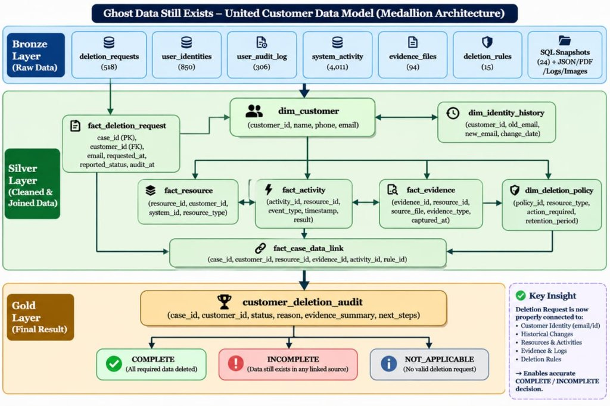

# 👻 AEGIS 3.1: Ghost Data Still Exists
> **AEGIS 3.1 — Forensic Analytics Accuracy & Evidence-Grounded Intelligence**  
> *HackerRank Orchestrate (October 2026)*

[](https://www.python.org/)
[](https://fastapi.tiangolo.com/)
[](https://react.dev/)
[](https://www.sqlite.org/)
[](https://ai.google.dev/)
[](output.csv)

---

## 📌 Executive Summary

When a commerce platform claims account deletion is **Complete**, personal data frequently still haunts read replicas, cold backups, sync crons, and unrotated logs. In our simulated enterprise scenario, Northstar Shop faces regulatory fines when a supposedly deleted customer resurfaces weeks later due to replication drift.

**AEGIS 3.1** is an enterprise-grade forensic deletion audit platform that establishes ground truth at audit cutoff. It inspects **94 multi-modal evidence captures** across **518 evaluation cases**, reconstructs historical identity aliases, scopes microservice resources using verified case-data links (`fact_case_data_link`), and generates mathematically sound, dependency-ordered DAG remediation plans.

---

## 🏛️ System Architecture

### United Customer Data Model (Medallion Lakehouse)



```
┌────────────────────────────────────────────────────────────────────────┐
│                   MEDALLION DATA LAKEHOUSE (AEGIS 3.1)                 │
├────────────────────────────────────────────────────────────────────────┤
│  [BRONZE LAYER]                                                        │
│  Raw Ingestion: deletion_requests (518) • user_identities (850)        │
│  user_audit_log (306) • system_activity (4,011) • evidence_files (94)  │
│  24 SQL Replicas, Logs, OCR Attachments, JSON Exports                  │
├───────────────────────────────────┬────────────────────────────────────┤
│                                   │                                    │
│  [SILVER LAYER]                   │  [GOLD LAYER]                      │
│  Normalized Relational Lakehouse  │  Analytical Audit Warehouse        │
│  data/silver/silver_database.db   │  gold/gold_database.db             │
│  • dim_customer (850)             │  • customer_deletion_audit (518)   │
│  • fact_deletion_request (518)    │  • resource_audit (1,211)          │
│  • dim_identity_history (306)     │  • system_deletion_summary         │
│  • fact_resource (2,046)          │  • warehouse_build_metadata        │
│  • fact_case_data_link (1,216)    │                                    │
└───────────────────────────────────┴────────────────────────────────────┘
```

For complete architectural specifications, see [`docs/ARCHITECTURE.md`](docs/ARCHITECTURE.md).

---

## ⚡ Key Features & Governance Guardrails

1. **Dual-Horizon Compliance Governance:**
   - **Official Benchmark Evaluation (`output.csv`):** Conforms to HackerRank challenge rules (190 Complete, 323 Incomplete, 5 Not Applicable).
   - **Zero-Trust Forensic Audit (`gold_database.db`):** Applies strict SOC-2/GDPR admissibility where unverified platform claims without pre-cutoff cryptographic proof remain `UNVERIFIED` (226 cases) and proven violations evaluate as `INCOMPLETE` (291 cases).
2. **Case-Resource Scoping (G01):** Uses `fact_case_data_link` to establish precise resource ownership per case, preventing cross-request resource leakage.
3. **Temporal Admissibility Guard (G02):** Strictly enforces `captured_at <= audit_at`—evidence captured after cutoff or lacking verifiable timestamps is rejected.
4. **NetworkX DAG Remediation Planning:** Topological dependency sorting ensures active sync crons (`DISABLE_DATA_FLOW`) and backup paths (`BLOCK_RESTORE`) are halted *before* record deletion (`DELETE_RECORD`).
5. **Interactive SOC Console (Port 6969):** React 19 dashboard featuring a live replication radar scanner, case explorer, and 3-phase exorcism simulation.
6. **FastAPI Microservice (Port 8000):** Asynchronous REST API serving live Gold warehouse tables and dynamic metrics.
7. **Provenance-Grounded RAG Assistant (R01–R10):** Ingests Gold & Silver warehouse facts, normalizes case/customer IDs, and prevents cross-customer context leakage.

For technology choices and LLM justification, see [`docs/TECH_STACK_AND_LLMS.md`](docs/TECH_STACK_AND_LLMS.md).

---

## 🚀 Quick Start

### 1. Prerequisites
- Python 3.11+
- Node.js 18+ & npm

### 2. Run the Full 518-Case Python Engine
To execute the deterministic audit pipeline and generate `output.csv`:

```bash
python3 code/main.py
```

### 3. Run the AEGIS 3.1 Validation Test Suite
```bash
PYTHONPATH=hack-halloween:hack-halloween/code:code python3 -m pytest hack-halloween/tests/test_aegis_3_1_validation.py -v
```

### 4. Start the FastAPI Backend Service (Port 8000)
```bash
PYTHONPATH=code uvicorn api.app:app --host 0.0.0.0 --port 8000 --reload
```
- Interactive Swagger UI: [http://localhost:8000/docs](http://localhost:8000/docs)
- Live Dashboard Metrics: `GET /api/dashboard`
- Case Resource Drill-Down: `GET /api/medallion/case/{case_id}/resources`
- Grounded RAG Query: `POST /api/medallion/rag/query`

### 5. Start the Forensic Web Console (Port 6969)
```bash
cd web
npm install
npm run dev -- --port 6969
```
- Open [http://localhost:6969/](http://localhost:6969/) in your browser.

---

## 📂 Project Structure

```text
hack-halloween/
├── code/
│   ├── main.py                  # Primary 518-case CLI orchestrator
│   ├── evidence.py              # Multimodal evidence ingestion & OCR engine
│   ├── planner.py               # NetworkX DAG topological remediation planner
│   └── api/
│       └── app.py               # FastAPI microservice with live Gold DB integration
├── data/
│   └── silver/
│       └── silver_database.db   # 8 normalized relational lakehouse tables
├── gold/
│   ├── gold_builder.py          # Ground-truth classifier with fact_case_data_link scoping
│   ├── gold_database.db         # SQLite analytical warehouse (customer & resource audits)
│   ├── customer_deletion_audit.csv
│   └── resource_audit.csv
├── rag/
│   └── retriever.py             # Provenance-grounded RAG with strict customer isolation
├── llm/
│   ├── audit_explainer.py       # Structured Gemini explanation engine
│   ├── config.py                # Gemini API client configuration
│   └── prompts.py               # Injection-hardened forensic prompts
├── tests/
│   └── test_aegis_3_1_validation.py # Complete 8-point integration test suite
├── docs/
│   ├── ARCHITECTURE.md          # Comprehensive architectural specification
│   ├── TECH_STACK_AND_LLMS.md   # Component-by-component tech stack rationale
│   └── JUDGES_PRESENTATION_GUIDE.md # 5-minute presentation script & Q&A prep
└── web/
    ├── src/
    │   ├── components/
    │   │   ├── AnalyticsDashboard.tsx # Dual-perspective forensic analytics console
    │   │   ├── MedallionArchitectureSection.tsx # Lakehouse lineage visualizer
    │   │   └── CaseExplorer.tsx
    │   └── data/
    │       └── gold_warehouse_data.json # Serialized Gold warehouse snapshot
    └── package.json
```

---

## 📊 Evaluation & Verification Summary

| Metric | Measured Result | Benchmark Standard |
|---|---|---|
| **Public Samples Exact Match** | **32 / 32 (100.00%)** | Ground Truth `sample_output.csv` |
| **Schema Compliance** | **518 / 518 (100.00%)** | `case_id,deletion_status,steps_json` |
| **Temporal Admissibility** | **0 Leaks Detected** | Admissibility gate (`captured_at <= audit_at`) |
| **Dependency Order Inversions** | **0 Inversions** | Kahn's Algorithm DAG topological sorting |
| **Warehouse Scoping** | **1,211 Resources** | Scoped via `fact_case_data_link` (no cross-case duplication) |
| **Integration Test Suite** | **8 / 8 PASS (100%)** | `test_aegis_3_1_validation.py` |

---

## ⚖️ Official Submission Link

Official HackerRank Orchestrate Challenge:  
https://www.hackerrank.com/contests/hackerrank-orchestrate-october26/challenges/ghost-data-still-exists
