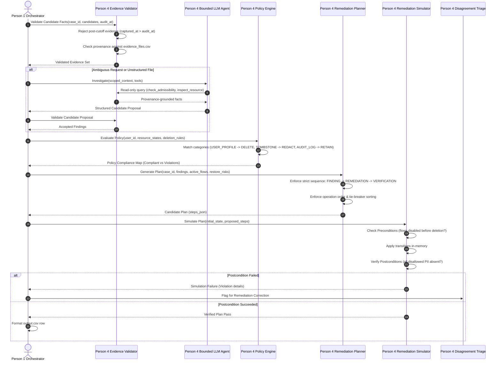

# PERSON 4 ARCHITECTURE: DATA FLOW & DECISION SOVEREIGNTY
**AEGIS 3.0 — HackerRank Orchestrate (October 2026)**  
**Component Architecture & Interaction Matrix**  

---

## 1. End-to-End Component Data Flow

The following sequence illustrates how a single case is processed through Person 4's boundaries:



---

## 2. Decision Sovereignty Matrix (Who Owns What)

To guarantee that no module oversteps its contract:

| Decision / Artifact | Sole Owner | Permitted Collaborators | Explicitly Banned |
| :--- | :--- | :--- | :--- |
| **Identity Resolution** | Person 3 | Uses Person 2's audit logs | **LLM cannot guess or alter identity** |
| **Evidence Admissibility** | Person 4 (`evidence_validator`) | Validates timestamps against `audit_at` | **LLM cannot override cutoff** |
| **Policy Mandate** | Person 4 (`policy_engine`) | Reads `deletion_rules.csv` | **No hardcoded case overrides** |
| **Unstructured Document OCR/Reading**| Person 4 (`bounded_agent`) | LLM vision/text extraction | **Cannot output un-grounded claims** |
| **Remediation Order** | Person 4 (`remediation_planner`)| NetworkX dependency DAG from Person 3 | **No arbitrary step insertion** |
| **Plan Feasibility** | Person 4 (`remediation_simulator`)| Applies transitions in-memory | **Cannot perform real external deletion** |
| **Final Deletion Status**| Person 1 (Orchestrator) | Reads simulator & policy evaluation | **LLM cannot set deletion_status** |
| **CSV Serialization**| Person 1 (Platform Lead) | Pydantic JSON dump | **No hand-crafted string concatenation** |

---

## 3. Simulator State Machine Specification

The Remediation Simulator is an in-memory, hermetic state engine that tests if the proposed plan actually fixes the problem without causing race conditions or zombie resurrections.

### State Transitions per Operation:

```
[PRESENT] ─── DISABLE_DATA_FLOW ───► [DISABLED] (Sync stopped)
[ACTIVE]  ─── BLOCK_RESTORE     ───► [BLOCKED]  (Backup locked)
[PRESENT] ─── DELETE_RECORD     ───► [ABSENT]   (Full purge)
[PRESENT] ─── REDACT_RECORD     ───► [REDACTED] (PII stripped, record kept)
[PRESENT] ─── ANONYMIZE_RECORD  ───► [ANONYMIZED] (Unlinked from user_id)
```

### Preconditions Verified by Simulator:
1. **Dependency Precondition**: A `DELETE_RECORD` on resource $R$ is **REJECTED** if there is an active `REPORT_ACTIVE_DATA_FLOW` or `REPORT_RESTORE_RISK` targeting $R$ that has not been preceded by `DISABLE_DATA_FLOW` or `BLOCK_RESTORE`.
2. **Downstream Precondition**: If resource $R_1$ replicates to $R_2$, $R_2$ must be deleted/redacted before or simultaneously with $R_1$.

### Postconditions Verified by Simulator:
1. Every record requiring `DELETE` must reach state `ABSENT`.
2. Every record requiring `REDACT` must reach state `REDACTED` with all direct PII fields verified missing.
3. Every record requiring `ANONYMIZE` must reach state `ANONYMIZED`.
4. Every policy-retained record (`SECURITY_AUDIT_LOG`, `LEGAL_HOLD_RECORD`) must remain `PRESENT`.
5. All active data flows must be `DISABLED` and restore risks `BLOCKED`.

