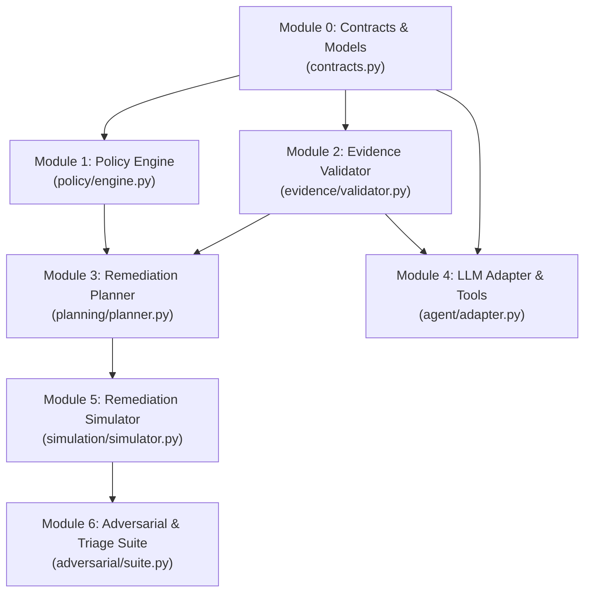

# PERSON 4 MODULE DEPENDENCIES & BUILD ORDER
**AEGIS 3.0 — HackerRank Orchestrate (October 2026)**  
**Module Graph, Execution Primitives & Cross-Team Handshakes**  

---

## 1. Internal Dependency & Implementation DAG

Every sub-module within Person 4 has a strict dependency order:

### Build Sequence:
1. **Module 0 (Done)**: Authoritative contracts and Pydantic schemas (`StepObject`, `EvidenceCandidate`, `DeletionRule`).
2. **Module 1**: `policy/engine.py` (Rule compilation and mapping). Zero external dependencies.
3. **Module 2**: `evidence/validator.py` (Temporal cutoff and manifest validation). Depends only on Module 0.
4. **Module 3**: `planning/planner.py` (Step ordering and formatting). Depends on Modules 0, 1, 2.
5. **Module 4**: `agent/adapter.py` (Bounded LLM investigator tools). Depends on Modules 0, 2.
6. **Module 5**: `simulation/simulator.py` (In-memory state transition tester). Depends on Modules 0, 1, 3.
7. **Module 6**: `adversarial/suite.py` (Mutation tests & disagreement triage). Depends on Module 5.

---

## 2. External Integration Handshakes

### Handshake with Person 2 (Ingestion & Data Engineering):
- **Input Received**: `List[EvidenceFact]` from SQLite/DuckDB.
- **Contract Expectation**: Person 2 must supply `file_id`, `locator`, `observed_at`, and `identifiers`. If `observed_at` is missing, Person 4 rejects it as unverifiable.

### Handshake with Person 3 (Identity & Graph):
- **Input Received**: `user_id`, list of historical aliases (emails, phones, hashes), and list of active `data_flow_ids` / `backup_ids` targeting the user's records.
- **Contract Expectation**: Person 3 provides the reachability DAG. Person 4 inspects this DAG to determine whether `REPORT_ACTIVE_DATA_FLOW` or `REPORT_RESTORE_RISK` is required.

### Handshake with Person 1 (Platform & Output):
- **Output Delivered**: Fully verified, ordered `List[StepObject]` for each `case_id`.
- **Contract Guarantee**: Person 4 guarantees that all steps in `List[StepObject]` strictly satisfy consecutive integer numbering (1..N), valid operations, correct phase ordering, and empty `evidence_id: ""` on proposed steps. Person 1 can directly dump this into `output.csv`.

