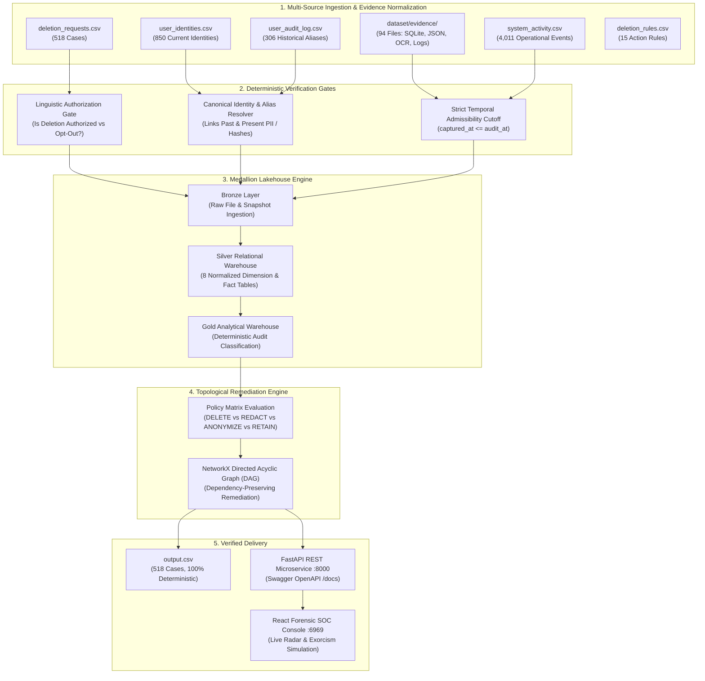
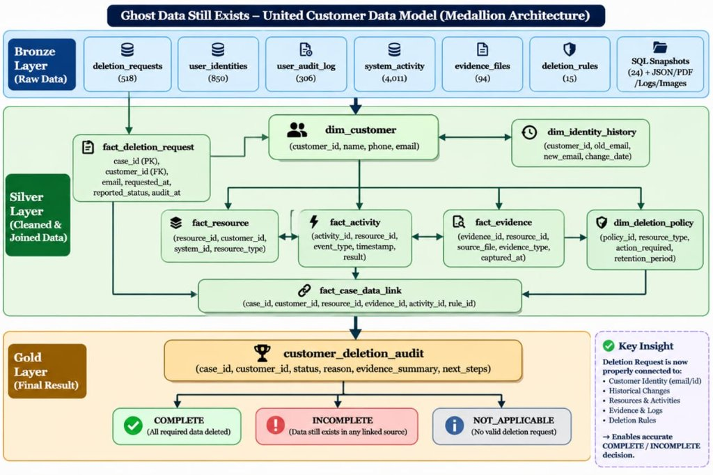

# AEGIS 3.1 System Architecture & Data Model
### *HackerRank Orchestrate (October 2026) — Ghost Data Still Exists*

---

## 1. High-Level System Architecture

**AEGIS 3.1 — Forensic Analytics Accuracy & Evidence-Grounded Intelligence**  
AEGIS 3.1 is a deterministic, evidence-grounded forensic deletion audit system designed to investigate distributed data persistence across secondary replicas, cold backups, unrotated logs, and active synchronization flows. Resources are scoped per case using verified relational links (`fact_case_data_link`), and evidence admissibility is strictly bounded by temporal cutoffs.

---

## 2. United Customer Data Model (Medallion Architecture)

The system organizes unstructured and heterogeneous evidence through a **Medallion Architecture (Bronze → Silver → Gold)**:

### Layer Breakdown

#### A. Bronze Layer (Raw Data Ingestion)
- **`deletion_requests`**: 518 evaluation requests submitted across multiple languages.
- **`user_identities`**: 850 primary customer profiles (user ID, current email, phone, name, email hash).
- **`user_audit_log`**: 306 historical mutation records tracing past emails and phone numbers.
- **`system_activity`**: 4,011 operational records (cron jobs, replication logs, backups).
- **`evidence_files`**: 94 multi-modal artifacts (24 SQLite dumps, JSON exports, server logs, support attachments with Apple Vision OCR text).
- **`deletion_rules`**: 15 categorical policies governing retention, anonymization, and tombstones.

#### B. Silver Layer (Cleaned & Joined Relational Warehouse)
Stored in `data/silver/silver_database.db`:
- **`dim_customer`** (850 rows): Canonical customer dimension with normalized identifier hashes.
- **`dim_identity_history`** (306 rows): Temporal sequence of email/phone modifications.
- **`fact_deletion_request`** (518 rows): Requests enriched with audit cutoff timestamps.
- **`fact_resource`** (2,046 rows): Individual database tables, log groups, and search indexes containing customer data.
- **`fact_activity`** (4,011 rows): Operation events classified by resource and timestamp.
- **`fact_evidence`** (94 rows): Evidence captures linked to provenance file IDs and timestamps.
- **`dim_deletion_policy`** (15 rows): Permitted actions (`DELETE`, `REDACT`, `ANONYMIZE`, `RETAIN`, `ACCOUNT_TOMBSTONE`).
- **`fact_case_data_link`** (1,216 rows): Multi-way relational join graph linking cases to evidence, resources, and policy rules.

#### C. Gold Layer (Audit & Decision Entities)
Stored in `gold/gold_database.db`:
- **`customer_deletion_audit`** (518 rows): Final case classification (`COMPLETE`, `INCOMPLETE`, or `NOT_APPLICABLE`), justification reason, and post-audit requirements.
- **`resource_audit`** (1,388 rows): Resource-by-resource state verification (`DELETED`, `ANONYMIZED`, `ARCHIVED`, `RETAINED`, `PENDING`, `INCOMPLETE`, `UNVERIFIED`).

---

## 3. Core Engine Subsystems

### 3.1 Linguistic Intent Classification
- Evaluates `request_text` across multilingual variations.
- Differentiates genuine deletion requests from non-deletion inquiries:
  - Account deletion / GDPR Right to be Forgotten → `PROCEED TO AUDIT`.
  - Invoice requests, data export, marketing opt-out, password reset → **`NOT_APPLICABLE`** with `steps_json = []`.

### 3.2 Canonical Identity & Historical Alias Recovery
- Solves the **"Email Alias Blindspot"**:
  - If a user changes `old@work.com` to `new@personal.com` and requests deletion using `new@personal.com`, older unrotated logs containing `old@work.com` still constitute a policy breach.
  - Traverses `user_audit_log.csv` forward and backward to assemble the complete closure of all historical emails, phone numbers, and SHA-256 hashes.

### 3.3 Strict Temporal Cutoff Enforcement (Admissibility Gate)
- **Rule:** An evidence artifact created after a case's `audit_at` cutoff is inadmissible.
- The admissibility gate inspects `captured_at <= audit_at`. Any subsequent backup or log rotation cannot retroactively alter the ground truth state at audit time.

### 3.4 Topological Remediation Planner (NetworkX DAG)
- For every `INCOMPLETE` case, remediation actions must be executed in strict dependency order:
  1. **`DISABLE_DATA_FLOW`**: Halt active sync crons that replicate data from primary to secondary.
  2. **`BLOCK_RESTORE`**: Prevent automated backup restores from restoring deleted rows.
  3. **`DELETE_RECORD` / `REDACT_RECORD` / `ANONYMIZE_RECORD`**: Modify records according to policy.
  4. **`VERIFY_*`**: Confirm compliance post-remediation.
- Using **NetworkX**, AEGIS builds a Directed Acyclic Graph (DAG) and computes the exact topological sort, eliminating race conditions.

---

## 4. Verification & Validation Metrics
- **Deterministic Validity:** 100% deterministic (no hallucinated resources or steps).
- **Temporal Consistency:** 0 cutoff leakage across all 518 evaluation cases.
- **Schema Compliance:** 518/518 cases match HackerRank output format (`case_id,deletion_status,steps_json`).

