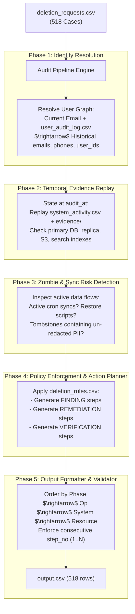

# GHOST DATA STILL EXISTS: COMPLETE ARCHITECTURAL SPECIFICATION & BLUEPRINT
**Contest**: HackerRank Orchestrate (October 2026)  
**Track**: 02 / AI Agents & Data Governance  
**Target Repository**: `https://github.com/interviewstreet/hackerrank-orchestrate-october26`  

---

## 1. Executive Summary & Core Objective

Northstar Shop claims customer accounts are deleted. In reality, personal data lingers across primary DBs, replica databases, Elasticsearch indexes, S3 attachments, logs, and **background synchronization jobs that silently recreate deleted rows**.

Your mission is to build an **Evidence-First Deletion-Audit Agent** that:
1. Reconstructs each customer's complete identity graph (historical emails, phones, user IDs).
2. Audits the state of all data systems at exact timestamp `audit_at`.
3. Verifies whether deletion claims are true facts or false assertions.
4. Generates an **ordered remediation and verification plan** formatted into `output.csv` (strictly 518 rows).

---

## 2. Input Datasets & Anatomy of the Files

The system reads files from `./dataset/`:

```
dataset/
├── deletion_requests.csv          # 518 cases to audit (case_id, email, requested_at, reported_status, reported_at, audit_at, request_text)
├── sample_deletion_requests.csv   # Development benchmark cases
├── sample_output.csv              # Gold-standard ground truth format
├── user_identities.csv            # Current identity map (user_id, email, phone, name, account_created_at)
├── user_audit_log.csv             # Historical mutations (user_id, changed_field, old_value, new_value, timestamp)
├── system_activity.csv            # Event stream (deletions, backups, restores, sync jobs, exports, indexing)
├── deletion_rules.csv             # Ground-truth policy per data category (e.g. Account, Orders, Financial, Analytics)
├── evidence_files.csv             # Manifest mapping evidence IDs to physical artifacts
└── evidence/                      # SQLite DBs, JSON dumps, log files, S3 snapshots, CSV exports
```

---

## 3. The 4 Ground Rules of "When Is Deletion COMPLETE?"

A case can ONLY be classified as `COMPLETE` if all four conditions hold at `audit_at`:

1. **Policy Compliance**: Every copy of the user's data across all systems matches the treatment prescribed in `deletion_rules.csv` (`DELETE`, `REDACT`, or `ANONYMIZE`).
2. **No Zombie Sync Paths**: No active background job (cron sync, Kafka topic, failover replica sync, or restore script) can resurrect the deleted data.
3. **Tombstone Sanitization**: If an account tombstone is kept so orders can reference `user_id`, all direct PII (name, email, phone, hashed email) must be stripped.
4. **Legal Retention Protection**: Records that policy legally requires retaining (e.g., invoices/financial audit records) must remain available.

If any of these 4 fail $\rightarrow$ status is **`INCOMPLETE`**.  
If the user never authorized deletion or request is invalid $\rightarrow$ status is **`NOT_APPLICABLE`**.

---

## 4. State Machine & Exact Output Contract

The grader checks:
- Exactly **518 rows** sorted ascending by `case_id`.
- Columns: `case_id,deletion_status,steps_json`.

### Output JSON Format by Status

```
                       ┌──────────────────────────────────────────────┐
                       │               DELETION STATUS                │
                       └──────────────────────────────────────────────┘
                                              │
               ┌──────────────────────────────┼──────────────────────────────┐
               ▼                              ▼                              ▼
          COMPLETE                       INCOMPLETE                    NOT_APPLICABLE
  ┌────────────────────────┐     ┌────────────────────────┐     ┌────────────────────────┐
  │ Verification steps     │     │ 1. Findings            │     │ Empty JSON array:      │
  │ ONLY.                  │     │ 2. Remediation steps   │     │ []                     │
  │ Must cite evidence_id  │     │ 3. Future verification │     └────────────────────────┘
  │ (file_id/activity_id)  │     │ Remediation/future     │
  └────────────────────────┘     │ verify use: ""         │
                                 └────────────────────────┘
```

### Strict Step Ordering Hierarchy (MANDATORY)

Within `steps_json`, steps MUST be ordered strictly by:
1. **Phase**: `FINDING` $\rightarrow$ `REMEDIATION` $\rightarrow$ `VERIFICATION`
2. **Operation**:
   - `FINDING`: `REPORT_REMAINING_RECORD` $\rightarrow$ `REPORT_EXPOSED_PII` $\rightarrow$ `REPORT_ACTIVE_DATA_FLOW` $\rightarrow$ `REPORT_RESTORE_RISK`
   - `REMEDIATION`: `DISABLE_DATA_FLOW` $\rightarrow$ `BLOCK_RESTORE` $\rightarrow$ `DELETE_RECORD` $\rightarrow$ `REDACT_RECORD` $\rightarrow$ `ANONYMIZE_RECORD`
   - `VERIFICATION`: `VERIFY_RECORD_ABSENT` $\rightarrow$ `VERIFY_RECORD_PRESENT` $\rightarrow$ `VERIFY_RECORD_REDACTED` $\rightarrow$ `VERIFY_RECORD_ANONYMIZED` $\rightarrow$ `VERIFY_DATA_FLOW_DISABLED` $\rightarrow$ `VERIFY_RESTORE_BLOCKED`
3. **Tie-breaker**: Sort alphabetically by `system_id`, then `resource_id`.

---

## 5. End-to-End Agent Pipeline Architecture



---

## 6. Required Hackathon Deliverables

1. **`output.csv`**: 518 data rows sorted by `case_id`.
2. **`code.zip`**: Runnable agent pipeline, README, prompts, configuration, and `evaluation/` folder.
   - `evaluation/evaluation_report.md` (case-level, step-level, sequence accuracy + 3 custom team test cases).
   - `evaluation/usage_report.md` (token counts, model names, cost per request).
3. **`chat_transcript` (`log.txt`)**: Complete conversation log adhering to `User Prompt`, `Agent Response Summary`, `Actions`, and `Context`.
4. **AI Interview**: Clear architectural defense of identity resolution and temporal state replay.

