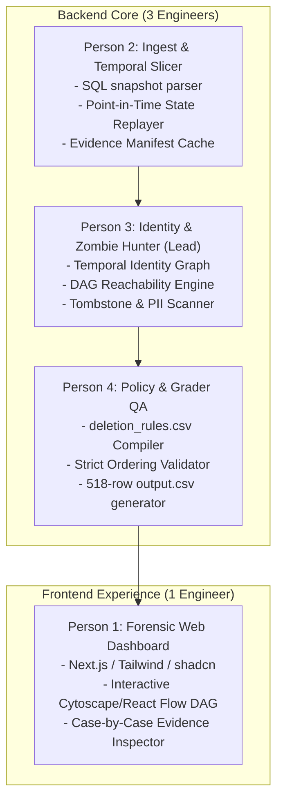

# MASTER PROJECT SPECIFICATION & DETAILED EXECUTION PLAN
**Project Codename**: `AEGIS` (Autonomous Evidence Graph & Identity Synapse)  
**Hackathon**: HackerRank Orchestrate — Ghost Data Still Exists  
**Target Repository**: `c:\Users\Admin\Desktop\Kshitiz\hackerrank-orchestrate-october26`  
**Team Allocation**: 4 Engineers (1 Frontend Lead, 3 Core Backend/ML/Governance)  
**Lead Architect**: Kshitiz  

---

## 1. The Core Problem Statement Deconstructed

### The Enterprise Nightmare ($2.4M Lawsuit Scenario)
Northstar Shop's primary account service deletes a customer record when requested and marks the ticket as **"COMPLETE"**. 
Weeks later, the customer attempts to register and is blocked with *"Email already registered"*. An audit reveals:
- The user's historical email or old phone number still existed in a read replica or an un-purged analytics export.
- An automated cron job (database sync / Kafka mirror / failover replica sync) detected the missing record in the primary DB and **re-inserted the ghost record** back into production.
- Customer support ticket attachments still contained un-redacted driver's license scans.
- An account tombstone retained the customer's full name and phone number instead of just the internal `user_id`.

### The Core Task
Build an **Evidence-First Deletion-Audit Agent** that takes 518 customer cases and determines:
1. Did the user actually authorize deletion in `request_text`? (If no $\rightarrow$ `NOT_APPLICABLE` with `[]`).
2. What is the customer's **complete identity graph**? (Connecting historical emails, phones, and UUIDs).
3. At the exact timestamp `audit_at`, what is the ground-truth state across:
   - Primary databases & SQL replicas (`dataset/evidence/databases/*.sql`)
   - Search indexes (`customer_search_primary`)
   - Customer support attachments (`dataset/evidence/documents/`, `images/`)
   - Logs & analytics exports (`dataset/evidence/logs/`, `records/`)
   - Active replication data flows & backup restore risks (`system_activity.csv`)
4. Output an exact `output.csv` with 518 rows sorted by `case_id`.

---

## 2. Mathematical State Machine & Rules Matrix

### The 4 Mandatory Conditions for `COMPLETE`
A case is `COMPLETE` **if and only if all four conditions hold at `audit_at`**:
1. **Policy Compliance**: Every relevant record matches `deletion_rules.csv` (`DELETE`, `REDACT`, or `ANONYMIZE`).
2. **No Active Zombie Sync**: No background data flow or restore process can recreate the data.
3. **Tombstone Sanitization**: Tombstone in `account_service` retains ONLY `user_id`; name, email, phone, and hashes must be `ABSENT`.
4. **Legal Retention**: Legally required records (Rule 12: Security audit logs, Rule 13: Legal holds) remain `PRESENT`.

If any condition fails $\rightarrow$ **`INCOMPLETE`**.  
If `request_text` is not a deletion request $\rightarrow$ **`NOT_APPLICABLE`**.

---

## 3. Allowed Operations & Exact Sorting Grammar

Every step in `steps_json` must strictly use this taxonomy:

| Phase | Allowed Operation | Allowed State | When Used |
| :--- | :--- | :--- | :--- |
| **FINDING** | `REPORT_REMAINING_RECORD` | `PRESENT` | Record exists that policy requires deleted. |
| **FINDING** | `REPORT_EXPOSED_PII` | `PRESENT` | Record may exist, but contains un-redacted PII. |
| **FINDING** | `REPORT_ACTIVE_DATA_FLOW` | `ACTIVE` | Background sync process can copy/recreate data. |
| **FINDING** | `REPORT_RESTORE_RISK` | `ACTIVE` | Backup/restore path can bring deleted data back. |
| **REMEDIATION** | `DISABLE_DATA_FLOW` | `DISABLED` | Stop the sync job. |
| **REMEDIATION** | `BLOCK_RESTORE` | `BLOCKED` | Prevent backup from restoring data. |
| **REMEDIATION** | `DELETE_RECORD` | `ABSENT` | Delete the record entirely. |
| **REMEDIATION** | `REDACT_RECORD` | `REDACTED` | Redact identifying fields. |
| **REMEDIATION** | `ANONYMIZE_RECORD` | `ANONYMIZED` | Irreversibly unlink from user. |
| **VERIFICATION**| `VERIFY_RECORD_ABSENT` | `ABSENT` | Confirm record does not exist. |
| **VERIFICATION**| `VERIFY_RECORD_PRESENT` | `PRESENT` | Confirm policy-required retained record exists. |
| **VERIFICATION**| `VERIFY_RECORD_REDACTED` | `REDACTED` | Confirm required fields removed. |
| **VERIFICATION**| `VERIFY_RECORD_ANONYMIZED` | `ANONYMIZED` | Confirm record unlinked. |
| **VERIFICATION**| `VERIFY_DATA_FLOW_DISABLED` | `DISABLED` | Confirm data flow inactive. |
| **VERIFICATION**| `VERIFY_RESTORE_BLOCKED` | `BLOCKED` | Confirm backup restore is blocked. |

### Strict Step Ordering Hierarchy (Page 4 of Brief)
1. **Phase Sequence**: `FINDING` $\rightarrow$ `REMEDIATION` $\rightarrow$ `VERIFICATION`.
2. **Operation Sequence**:
   - `FINDING`: `REPORT_REMAINING_RECORD` $\rightarrow$ `REPORT_EXPOSED_PII` $\rightarrow$ `REPORT_ACTIVE_DATA_FLOW` $\rightarrow$ `REPORT_RESTORE_RISK`
   - `REMEDIATION`: `DISABLE_DATA_FLOW` $\rightarrow$ `BLOCK_RESTORE` $\rightarrow$ `DELETE_RECORD` $\rightarrow$ `REDACT_RECORD` $\rightarrow$ `ANONYMIZE_RECORD`
   - `VERIFICATION`: `VERIFY_RECORD_ABSENT` $\rightarrow$ `VERIFY_RECORD_PRESENT` $\rightarrow$ `VERIFY_RECORD_REDACTED` $\rightarrow$ `VERIFY_RECORD_ANONYMIZED` $\rightarrow$ `VERIFY_DATA_FLOW_DISABLED` $\rightarrow$ `VERIFY_RESTORE_BLOCKED`
3. **Deterministic Tie-breaker**: Sort alphabetically by `system_id` ascending, then `resource_id` ascending.
4. **Step Numbering**: `step_no` must start at `1` and increment consecutively (`1, 2, 3...`).

---

## 4. 4-Person Team Distribution & Concrete Work Allocation

### 👤 Person 1: Frontend & Visual Forensic Experience (1 Engineer)
- **Mission**: Build an interactive, executive-grade forensic dashboard that visualizes the zombie data flows and deletion audit trails.
- **Tech Stack**: Next.js (App Router), Tailwind CSS, shadcn/ui, `lucide-react`, **React Flow** / **Cytoscape.js**.
- **Deliverables**:
  1. *Executive Summary*: Donut charts of 518 cases (Complete, Incomplete, N/A), violation counts, zombie sync breakdown.
  2. *Interactive Case Explorer*: Dropdown of `case_001` to `case_518`. Shows:
     - The resolved Identity Tree (Current email, past emails, phone numbers, account IDs).
     - The interactive System DAG (Visualizing the primary DB, replicas, and active sync jobs in red).
     - The Step Plan Timeline (`FINDING` $\rightarrow$ `REMEDIATION` $\rightarrow$ `VERIFICATION` with clickable evidence links).
- **Asset Reuse**: Adapt UI structure and styles from `SIH-DNS-wala-project/dashboard` and `ney-heritage-design-template`.

### 👤 Person 2: Multi-Format Ingestion & Temporal State Engine (1 Engineer)
- **Mission**: Parse all multi-format evidence and establish the exact state of all resources at timestamp `audit_at`.
- **Tech Stack**: Python 3.11, DuckDB / SQLite, Pandas.
- **Deliverables**:
  1. Parse all SQL dumps in `dataset/evidence/databases/` into in-memory SQLite tables.
  2. Index documents, logs, and attachments from `dataset/evidence/`.
  3. Implement **Point-in-Time Temporal Replay**: Given `audit_at`, query whether a record existed *at that moment*, filtering out events that occurred after `audit_at`.

### 👤 Person 3: Identity Graph Disambiguation & Zombie Synapse Hunter (1 Engineer - You/Lead)
- **Mission**: Build the core analytical brains — resolving identities and discovering hidden sync loops.
- **Tech Stack**: Python, NetworkX, Vector Embeddings.
- **Deliverables**:
  1. **Temporal Identity Graph**:
     - Connect `user_identities.csv` + `user_audit_log.csv` $\rightarrow$ build graph of every alias, historical email, and telephone number linked to the case.
  2. **Zombie Data Flow & Restore Risk Engine**:
     - Scan `system_activity.csv` for data flows where source system still has data and target system was supposedly wiped.
     - Detect active backup archives that have not been blocked.
  3. **Tombstone & PII Verifier**:
     - Inspect account tombstones to verify whether direct PII (name, email, phone) was stripped.

### 👤 Person 4: Policy Enforcement, Strict Ordering & Grader QA (1 Engineer)
- **Mission**: Guarantee 100% precision on `output.csv` with zero grading penalties.
- **Tech Stack**: Python, JSON Schema validation.
- **Deliverables**:
  1. **Policy Rules Engine**: Map records to `deletion_rules.csv` (Rules 01–15) to decide whether to delete, redact, or retain.
  2. **Deterministic Step Sorter**: Enforce strict phase ordering, operation sequence, tie-breaker sorting, and consecutive `step_no` numbering.
  3. **Evaluation & Audit Reports**:
     - `evaluation/evaluation_report.md` (Documenting case-level accuracy, step accuracy, sequence accuracy, and 3 custom team test cases).
     - `evaluation/usage_report.md` (Documenting token counts, model calls, and cost).
     - `log.txt` (Maintaining the chat transcript conforming to the required format).

---

## 5. Winning Strategy Roadmap (Hour-by-Hour)

| Sprint | Timeline | Objectives & Milestones |
| :--- | :--- | :--- |
| **Sprint 1** | **Hours 1–3** | • Run baseline parser on `sample_deletion_requests.csv`. • Build Identity Graph Resolver on `user_audit_log.csv`. • Wire SQLite in-memory loaders for `evidence/databases/*.sql`. |
| **Sprint 2** | **Hours 4–7** | • Build the Temporal State Slicer at `audit_at`. • Implement Zombie Data Flow & Restore Risk detector from `system_activity.csv`. • Code the `deletion_rules.csv` policy compiler. |
| **Sprint 3** | **Hours 8–10** | • Integrate strict step ordering and generate steps for sample cases. • **Gold Standard Benchmark**: Validate output against `sample_output.csv` until 100% exact match. • Person 1 connects frontend dashboard to output JSON. |
| **Sprint 4** | **Hours 11–13** | • Run full dataset run across all 518 cases to produce `output.csv`. • Generate `evaluation/evaluation_report.md` and `evaluation/usage_report.md`. • Run packaging script to generate clean `code.zip` (excluding datasets and venvs). |
| **Sprint 5** | **Hour 14** | • Final validation checklist verification. • Rehearse AI Interview presentation narrative. |

---
*Location: `c:\Users\Admin\Desktop\Kshitiz\GHOST_DATA_DETAILED_MASTER_PLAN.md` — Pinned in workspace.*

