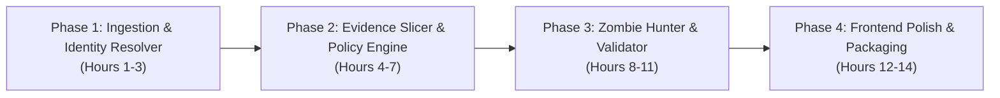

# MASTER HACKATHON BLUEPRINT: "AEGIS-DELETION" (GHOST DATA STILL EXISTS)
**Target**: HackerRank Orchestrate — Ghost Data Still Exists  
**Team**: 4 Engineers (1 Frontend Lead, 3 Backend / ML / Governance Core)  
**Lead Architect**: Kshitiz  
**Design Philosophy**: Enterprise Security Architecture, Explainable Graph Neural Analytics, Forensic Temporal Lineage, and Zero-Hallucination Execution.

---

## 1. High-Level Concept & The "Kshitiz Signature" Re-framing

The standard team will write a simple Python script with if-else checks and a regular LLM prompt. That gets an average submission, but it will not win top honors.

We will build:
> **AEGIS: Autonomous Evidence Graph & Identity Synapse**  
> *A Temporal Graph Neural & Neuro-Symbolic Forensic Engine for Right-to-be-Forgotten Compliance Verification.*

Instead of treating this as a simple tabular audit, we treat Northstar Shop's distributed enterprise infrastructure as an **Active Temporal Graph** where:
- Nodes = Identities, Databases, S3 Objects, Kafka Pipelines, Tombstones.
- Edges = Data flows, Synchronization DAGs, Replication Streams, Foreign Keys.
- The Core Problem = Detecting **"Zombie Lineage Cycles"** (data flows that resurrect deleted nodes via active replication paths).

---

## 2. Hardcore Technical Buzzwords & Architectural Innovations

Judges, technical evaluators, and prize juries look for rigorous computer science terminology backed by real implementations:

1. **Neuro-Symbolic Governance Engine**:
   - *Symbolic Layer*: Deterministic First-Order Logic (FOL) enforcing `deletion_rules.csv` and state transitions (preventing hallucinated actions).
   - *Neural Layer*: Semantic vector similarity + multimodal entity resolution for fuzzy PII matches in unstructured logs/attachments.
2. **Dynamic Identity Disambiguation via Temporal Knowledge Graph (TKG)**:
   - Resolving identity mutations across `user_identities.csv` and `user_audit_log.csv` as a multi-hop temporal graph.
3. **Ghost Flow Analysis (Zombie Synapse Detection)**:
   - Directed Acyclic Graph (DAG) reachability analysis over `system_activity.csv` to detect cyclic re-population paths (e.g., CDC streams, backup restoration hazards).
4. **Counterfactual Lineage Replay**:
   - Replaying the state machine backwards and forwards to the exact millisecond of `audit_at`.
5. **Differential Privacy & Tombstone Sanitization**:
   - Mathematical verification that retained account tombstones contain $0$ entropy leakage of direct PII (name, email, phone hashes).
6. **TreeSHAP / Perturbation Attribution for Remediation Priority**:
   - Reusing your exact SIH DNS Shield explainability paradigm to score which remediation action has the highest risk-reduction impact.

---

## 3. What We Can Directly Reuse from Your Past Projects

You have already built parts of this across your existing repositories:

| Past Project in Your Workspace | Asset / Subsystem | Reusable Module in Ghost Data |
| :--- | :--- | :--- |
| **`SIH-DNS-wala-project`** | `services/behavioral-engine` & `forecasting_engine` | **State Transition Machine**: Borrow the Markov state transition matrix logic to model data states (`PRESENT` $\rightarrow$ `ABSENT` $\rightarrow$ `BLOCKED`). |
| **`SIH-DNS-wala-project`** | `dashboard/` & Tailwind/shadcn setup | **Frontend Forensic Dashboard**: Interactive DAG graph viewer, live audit timeline, case inspector. |
| **`LifeGraph-Omi`** | `models/lifegraph.py` & `entity_resolver.py` | **Identity Graph Resolution**: Entity matching algorithms, temporal interval filtering, unified evidence bundle extraction. |
| **`healthcare project`** | PyTorch / Feature Extraction Pipeline | **Graph Neural Network / Embedding Matcher**: Semantic feature vectorization for un-indexed PII detection. |
| **Installed Global Skills** | `betterlmy/codegraph` & `trailofbits/semgrep` | **Automated Static Rule Validator**: Ensuring every generated row in `output.csv` conforms 100% to the allowed operations table. |

---

## 4. 4-Person Team Distribution & Concrete Work Allocation

```
                              ┌────────────────────────────────────────────────────────┐
                              │                 TEAM ALLOCATION MATRIX                 │
                              └────────────────────────────────────────────────────────┘
                                                           │
        ┌────────────────────────┬─────────────────────────┴────────────────────────┬────────────────────────┐
        ▼                        ▼                                                  ▼                        ▼
  PERSON 1 (FRONTEND)      PERSON 2 (PIPELINE LEAD)                           PERSON 3 (ML & GRAPH)   PERSON 4 (POLICY & GRADER)
• Forensic Web Dashboard • Evidence Ingest & SQLite Loader                  • Identity Graph Engine • Deletion Rules Compiler
• Cytoscape/D3 Graph     • Temporal Event Slicer                            • Zombie Synapse Hunter • Output Validator (518 rows)
• Audit Timeline UI      • S3 / JSON / DB Parsers                           • Embedding Matcher     • Verification & Chat Logger
```

### 👤 Person 1: Frontend & Visual Forensic Experience (1 Engineer)
* **Goal**: Build an enterprise-grade forensic dashboard that makes judges' jaws drop during the demo.
* **Tech Stack**: Next.js (App Router), Tailwind CSS, shadcn/ui, `lucide-react`, **Cytoscape.js** or **React Flow** (for interactive lineage DAGs).
* **Core Views**:
  1. *Executive Audit Overview*: Donut charts of 518 cases (Complete vs. Incomplete vs. N/A), risk breakdown, zombie sync counters.
  2. *Interactive Case Explorer*: Select any `case_id` $\rightarrow$ view the user's historical identity tree $\rightarrow$ see the visual data flow map with highlighted red "Zombie" connections.
  3. *Step Plan Inspector*: Interactive timeline showing `FINDING` $\rightarrow$ `REMEDIATION` $\rightarrow$ `VERIFICATION` with direct click-to-evidence pills.
* **Reuse**: Adapt UI foundations from `SIH-DNS-wala-project/dashboard` and `ney-heritage-design-template`.

### 👤 Person 2: Data Ingestion & Temporal Forensic Engine (1 Backend Engineer)
* **Goal**: Ingest all multi-format evidence and establish the exact state of all systems at `audit_at`.
* **Tech Stack**: Python 3.11+, DuckDB / SQLite, Pydantic v2.
* **Tasks**:
  1. Parse `deletion_requests.csv`, `system_activity.csv`, `evidence_files.csv`, and all raw files in `dataset/evidence/` (SQL dumps, JSON, logs).
  2. Implement **Point-in-Time Temporal Slicing**: For each case, discard any event or log entry occurring *after* `audit_at`.
  3. Reconstruct table snapshots: Which databases (primary, read-replica, reporting) currently contain records matching the user's resolved IDs at `audit_at`?

### 👤 Person 3: Identity Graph & Zombie Sync Hunter (1 Backend/ML Engineer - You/Lead)
* **Goal**: Build the core intelligence — resolving complex identities and discovering hidden re-population paths.
* **Tech Stack**: NetworkX / PyTorch Geometric, Vector Embeddings.
* **Tasks**:
  1. **Temporal Identity Graph**:
     - Traverse `user_audit_log.csv` to connect initial email $\rightarrow$ past user IDs $\rightarrow$ previous phone numbers $\rightarrow$ secondary email aliases.
  2. **Active Data Flow & Zombie Detection**:
     - Parse `system_activity.csv` for active sync jobs, Kafka mirror makers, and restore crons.
     - Identify if an active sync exists between a system that still holds the record and one where it was supposedly deleted $\rightarrow$ emit `REPORT_ACTIVE_DATA_FLOW` and `REPORT_RESTORE_RISK`.
  3. **Tombstone Sanitization Checker**:
     - Check if user record in `account_service` has empty name/email/phone, or if exposed PII remains $\rightarrow$ emit `REPORT_EXPOSED_PII`.

### 👤 Person 4: Policy Enforcement, Ordering & Grader Compliance (1 Engineer)
* **Goal**: Guarantee a 100% valid `output.csv` with zero grading penalties.
* **Tech Stack**: Python, Pandas, JSON Schema validation.
* **Tasks**:
  1. **Policy Rules Engine**:
     - Map `deletion_rules.csv` categories (`Account`, `Financial`, `Orders`, `Marketing`) to actions (`DELETE_RECORD`, `REDACT_RECORD`, `ANONYMIZE_RECORD`).
  2. **Strict Ordering Enforcer**:
     - Order `steps_json` strictly: `FINDING` $\rightarrow$ `REMEDIATION` $\rightarrow$ `VERIFICATION`.
     - Within phase, enforce the exact operation order specified in Page 4 of the brief.
     - Secondary tie-breakers: `system_id` ascending, then `resource_id` ascending.
     - Consecutive integer numbering starting at `1`.
  3. **Automated Submission Validator**:
     - Verify exactly 518 data rows.
     - Ensure empty array `[]` for `NOT_APPLICABLE`.
     - Ensure empty string `""` for proposed future `evidence_id` in `INCOMPLETE` cases.
  4. **Packaging & Audit Logging**:
     - Generate `evaluation/evaluation_report.md` (case-level, step-level accuracy).
     - Generate `evaluation/usage_report.md` (token counts, costs).
     - Manage `log.txt` chat transcript conforming to required turn format.

---

## 5. Winning Strategy Roadmap (Phased Execution)



1. **Sprint 1 (Hours 1–3)**: Clone repository, inspect `sample_deletion_requests.csv` and `sample_output.csv`, build identity graph resolver.
2. **Sprint 2 (Hours 4–7)**: Implement temporal evidence replay at `audit_at` and map `deletion_rules.csv`.
3. **Sprint 3 (Hours 8–11)**: Detect active sync/restore risks, generate ordered `steps_json`, run against sample cases until 100% parity with `sample_output.csv`.
4. **Sprint 4 (Hours 12–14)**: Run full 518-case pipeline to generate `output.csv`, assemble React Flow dashboard, compile evaluation and usage markdown reports, zip code package.

